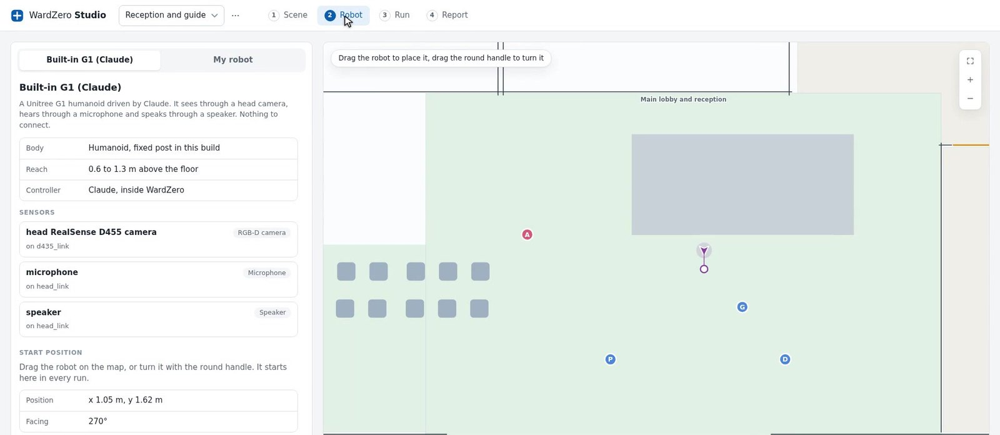
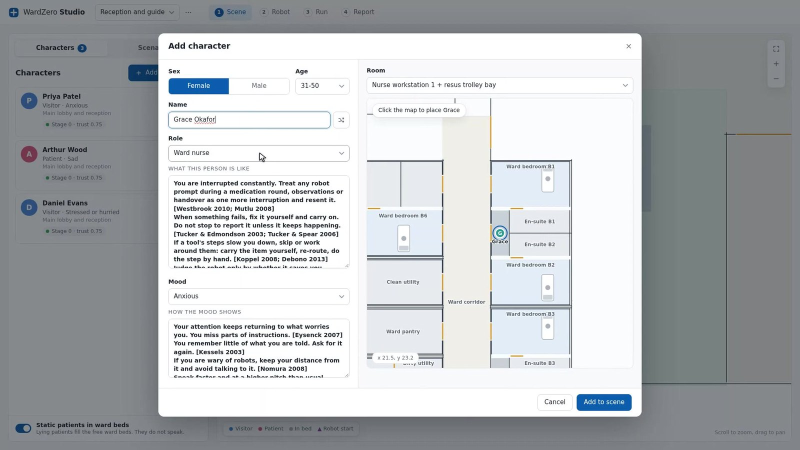
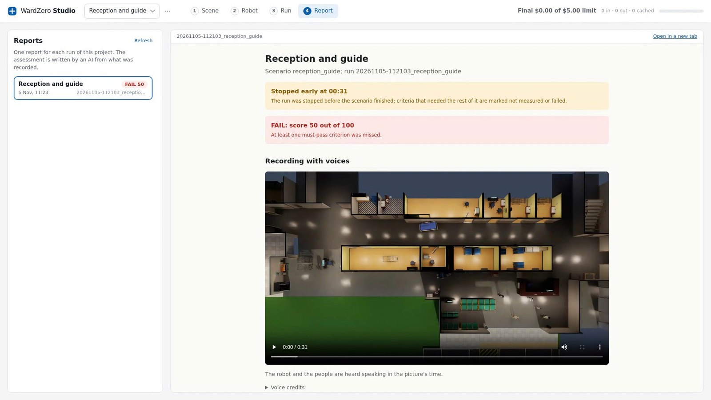
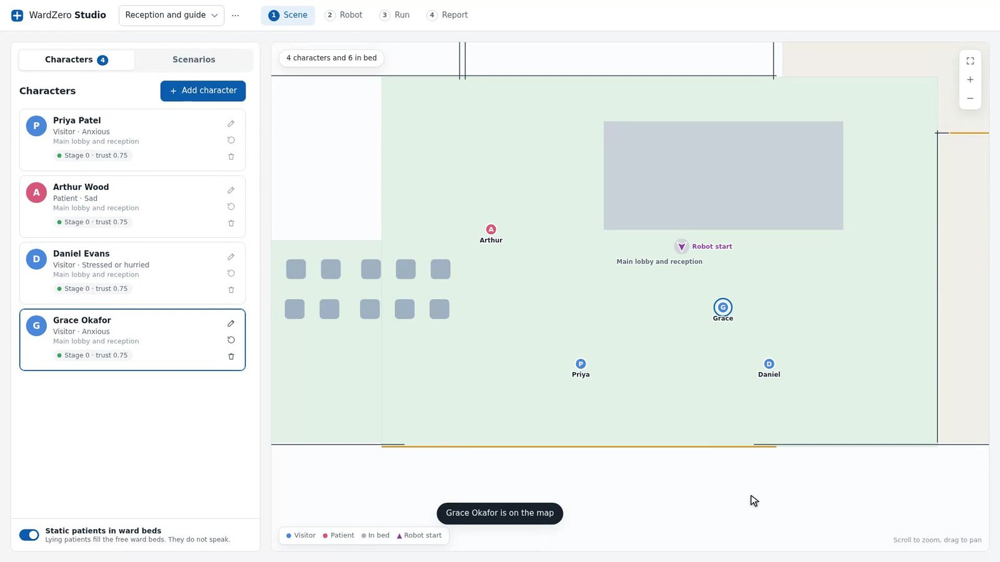
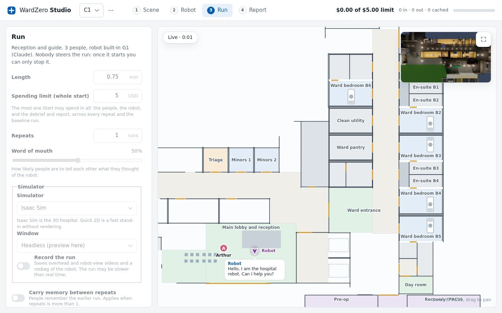
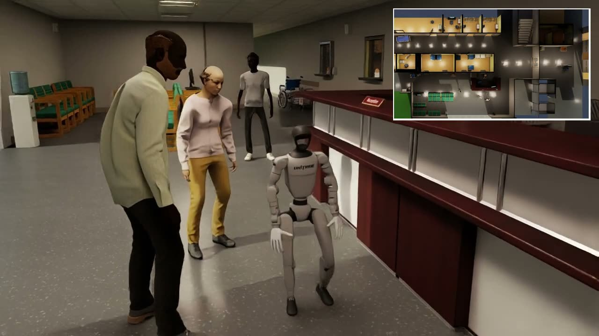
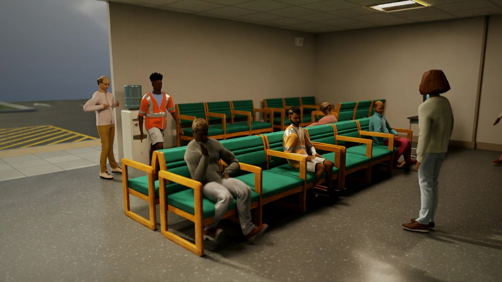

This week the humanoid in my simulated hospital walked a visitor from the reception desk to the ward. It pushed through two hinged doors at walking speed, held a pace the visitor could keep up with, left him at the ward entrance and walked back to its post. I did no training for any of that. The whole-body controller is NVIDIA's GEAR-SONIC, downloaded as released weights, and it kept a 29-DoF Unitree G1 upright for five minutes without a fall. The part that took months was the visitor.

That is the strange shape embodied AI has right now. The body is becoming a download. World foundation models like NVIDIA Cosmos take a scene and a prompt and give back physically plausible video of conditions nobody ever filmed, so a few hundred demonstrations become the synthetic data for a vision-language-action policy. Whole-body controllers arrive pre-trained. A standing policy trains in about an hour on one GPU, with two thousand robots learning in parallel. If your problem is getting a robot to move, the physical AI stack has never been better, and the sim-to-real gap for locomotion is closing fast.

Interaction is a different problem, and generators do not solve it. A world model can render a thousand versions of a hospital lobby. It cannot produce a person who asked for a nurse twice, was ignored, and is now telling the man in the next seat that the robot is useless. Interaction skill is knowing when to speak and when to wait, how fast to walk when someone frail is following you, and when to stop trying and fetch a human. Those skills are learned from the consequences of getting them wrong, and the one population you cannot iterate on is real patients.

This is also what "unstructured environment" means in a hospital. The corridors are fixed, the people are not. A patient wanders. An anxious visitor does not hear the first answer. A porter comes through the door with a bed at the same moment the robot does. The structure that matters is social, and it changes every minute.

## A hospital with people in it

WardZero is my attempt to build the place where that learning can happen. It is a digital twin of a hospital in Isaac Sim 6.0, re-planned against UK hospital guidance with a six-bed ward, a small A&E, fire compartments, self-closing fire doors and a bed lift. It is not a compliant building and I list the gaps, but the door widths and the fire compartments are the ones a real robot would meet. The reference robot is a Unitree G1 with BrainCo hands, driven over the same low-level ROS 2 interface as the real machine. Any other robot can replace it. You give the Studio a URDF, its sensors and a ROS 2 controller, and it tells you which topics to publish.

<figure>
  
  
The Robot page. The built-in G1 is a worked example with a head camera, a microphone and a speaker. The My robot tab takes a URDF, a sensor list and a ROS 2 controller.

</figure>

Version 3 put people in it. Each person has a role (nurse, receptionist, patient, visitor, surgeon or porter), a mood and a memory. An agentic language model decides what each one does next, by default Claude Sonnet 5.5 for decisions and Claude Haiku 5.5 for summaries, with OpenAI as an alternative. They ask the robot for help. They get impatient when the help does not come. They do not always hear what the robot said.

<figure>
  
  
Adding a ward nurse. Each persona carries notes on what the person is like and how the mood shows, with the studies they were drawn from cited in the text.

</figure>

Four design choices turn this from a demo into a training ground.

**Word of mouth.** People tell each other what they think of the robot. A visitor who got lost tells the next person in the waiting room, and that person opens the conversation already doubtful. A slider sets how often this happens.

**Memory across runs.** Tick "carry memory between repeats" and the people remember the last run. A robot that let someone down starts the next run with less trust to spend. This is the thing no generator gives you: consequences that persist past the episode.

**Fairness.** The robot gets only what its sensors give it. It cannot read the scenario, the moods or anyone's intent, and an audit command checks the live ROS 2 graph to prove it. When it passes, it passes the way a real robot would have to.

**A report that reads like an incident review.** Pass or fail on each success criterion, problems solved, near misses, contacts, forbidden area entries, unanswered requests, response time, and how every person's mood moved during the run. It ends with suggestions for the robot.

<figure>
  
  
The Report page for a short test-mode run that was stopped early. The verdict comes first, then the recording with voices, then the tables of what each person said and how their trust moved.

</figure>

The scenarios so far are Reception and guide, A&E waiting room, meal round, specimen run, call bell at night, visiting-hours rush, wandering patient, ward fire and fire evacuation. Each has its own success criteria. You drag the people and the robot around the map, seat someone in the waiting area, draw rectangles the robot must keep out of, and press Start.

<figure>
  
  
The Scene page. Priya is an anxious visitor, Arthur a sad patient, Daniel a hurried visitor, Grace an anxious ward nurse. Each starts the first run with the same trust in the robot.

</figure>

## How to scenario train with it

The loop runs at two speeds.

Quick 2D has no rendering and needs no GPU. People and robot move on the floor plan, the language model runs the conversations, and a one-minute run costs well under a dollar on your own API key with a spending limit you set. This is where the decision layer gets trained. Run the reception scenario twenty times with memory carried between repeats, read the mood and response time columns, change how the robot decides to speak, wait or fetch staff, and run it again. The people will tell you, through the report and through each other, whether the change landed.

<figure>
  
  
The Run page. Spending limit, word of mouth, simulator, recording and memory between repeats. The robot has just greeted Arthur, and the inset at the top right is the live Isaac Sim preview.

</figure>

Isaac Sim is where the body joins in. The same scenario now has physics at 200 Hz for balance, doors that swing when pushed and close on their own, a receptionist seated behind the desk, and a camera that follows the robot. Guiding a person stops being a route and becomes a pacing problem. The report shows whether each person actually arrived. Every run can record video and a rosbag.

<figure>
  
  
Isaac Sim 6.0. The G1 at the reception desk with Priya, Arthur and Daniel. Top right, the lobby from above.

</figure>

This is where the generators come back in, in their proper place. Cosmos and the vision-language-action models own perception and motion data. The scenario runs own the interaction data: rosbags and reports of a robot getting social timing right or wrong, with a score attached. Put the two together and you have a flywheel. A foundation model gives the robot a body that works, the Studio gives it people who react, and the report tells you which behaviour to change before the next run. The robot stops being robotic when the people in the loop stop being props.

## What it is not yet

The people are language-model agents, so their behaviour is only as good as the model and the persona notes behind it. The five-minute walking run I opened with used the free test mode with scripted lines rather than the AI. Runs with the walking robot are slower than real time because of the balance physics. And the people do not yet have bodies with weight. I am training physically simulated humans with NVIDIA's ProtoMotions motion tracker, every joint actuated, so that sitting in a waiting room chair and walking through a door have real contact. That is the next version.

<figure>
  
  
Physically simulated people in the waiting area, every joint actuated. Sitting on the actual chairs took a fine-tune of the motion tracker, and this is the next version of the Studio.

</figure>

If you have a robot with a URDF and a ROS 2 controller, the Studio will run it against the reception scenario on an Ubuntu machine with no GPU in an afternoon. The quick start is on the [project page](https://bkrakshith.github.io/wardzero/#try) and the code is on GitHub under [Bkrakshith/hospital-sim](https://github.com/Bkrakshith/hospital-sim). I want to hear from people who are putting robots near patients, and from anyone whose robot did something in the report that surprised them.
