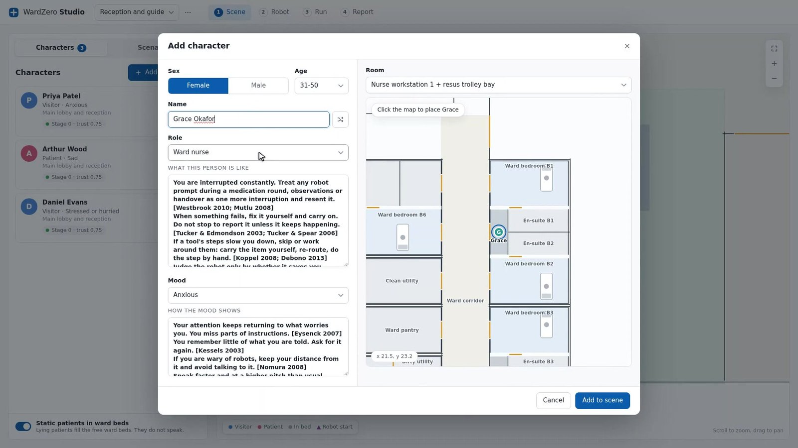
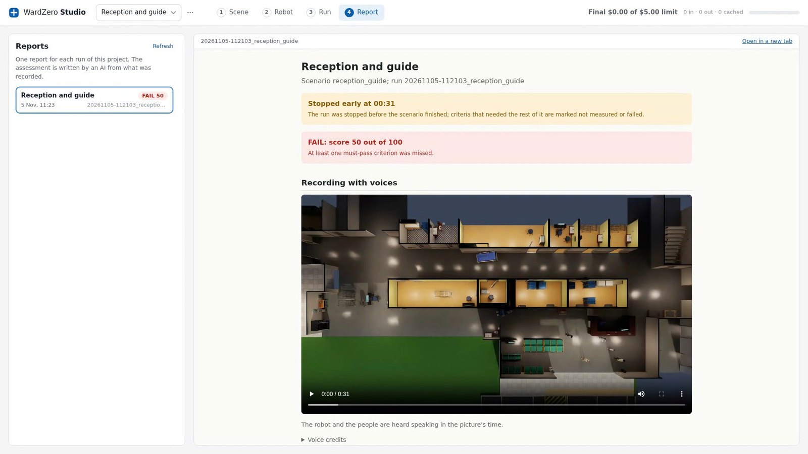
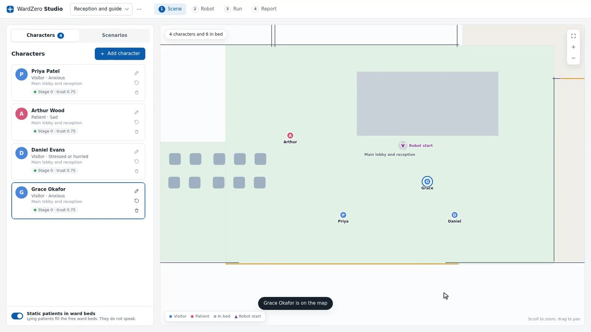
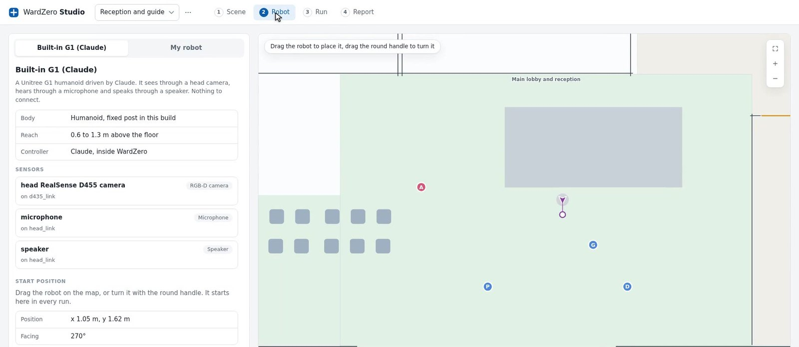
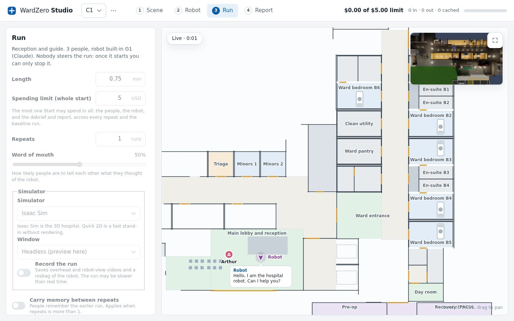
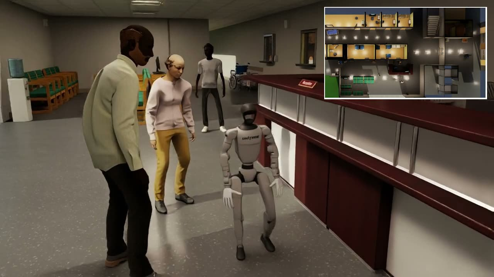
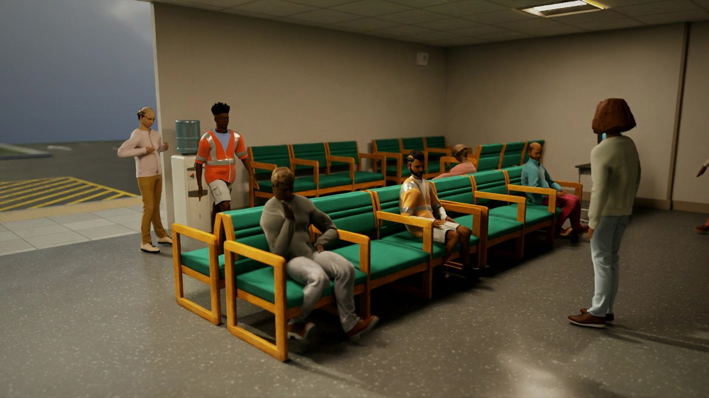

This week the humanoid in my simulated hospital walked a visitor from the reception desk to the ward. It pushed through two hinged doors at walking speed, held a pace the visitor could keep up with, left him at the ward entrance and walked back to its post. I did no training for any of that. The whole-body controller is NVIDIA's GEAR-SONIC, downloaded as released weights, and it kept a 29-DoF Unitree G1 upright for five minutes without a fall. The part that took me weeks was the visitor.

## Why a hospital

I did not start this to build simulated people. I started it because of a number. Lord Darzi's 2024 investigation into the NHS found staff working harder than before the pandemic and getting less done, with too little automation in the labs and pharmacies and too little digital support on the wards. The government's answer is a ten year plan built on a shift from analogue to digital. Robots sit at the far end of that shift, and nobody in the system has a safe place to try one.

Elon Musk keeps saying that the only way the United States will clear its national debt is AI and robots, most recently to Walter Isaacson. I think he is right about the direction, and the UK runs the same arithmetic with an older population and a health service that is the largest departmental budget. Healthcare is also where it stops being arithmetic for me. In a warehouse a productivity gain is a number on a dashboard. On a ward it is a nurse's hour given back, and the person at the other end of that hour is a patient who waited.

It is also why nobody can do the obvious thing. You cannot iterate a robot on patients. A startup with a humanoid and a good pitch has nowhere to let it get things wrong a thousand times before the first real trial, so I built the place where getting it wrong is cheap.

## What I got wrong first

Version 1 was the robot. A Unitree G1 with BrainCo hands, one URDF feeding both MuJoCo and Isaac Sim, the real robot's low-level ROS 2 interface, a mode manager with a proper hold state, slam_toolbox and Nav2 walking a 60-point route through the building. I assumed the hospital was set dressing and the people would be props.

The building went first. The stock hospital I started from was not one a UK robot would ever meet, so version 2 re-planned it against UK hospital guidance: a six-bed ward with en-suites, a small A&E with its own ambulance entrance, three fire compartments, self-closing fire doors, a bed lift by the main entrance, and a link corridor widened to four metres because beds need the clearance. It is still not a compliant building and I list the gaps, but the doors and the widths are the ones a real robot would have to deal with.

Then the people went. I put simulated humans in the lobby and the first thing they did was walk through the walls. The collision set was a cropped box of the building that missed whole walls, the fire partitions included, so as far as a human was concerned those walls did not exist. Baking every visible mesh into a collision file fixed it, and the fix should have shipped with version 2. I mention it because the same thing kept happening. Every time I thought the robot was the problem, the world around it was.

Version 3 was the admission that the people were the point.

## The body became a download

While I was doing that, the other half of embodied AI moved on without me. I had started training my own whole-body controller for the G1. It learned to stand, and then I swapped it for NVIDIA's released GEAR-SONIC and retired the folder. World foundation models like NVIDIA Cosmos now take a scene and a prompt and give back physically plausible video of conditions nobody filmed, so a few hundred demonstrations become the synthetic data for a vision-language-action policy. If your problem is getting a robot to move, the physical AI stack has never been better, and the sim-to-real gap for locomotion is closing fast.

What none of that generates is a person who asked for a nurse twice, was ignored, and is now telling the man in the next seat that the robot is useless. A world model can render a thousand lobbies. It cannot give you consequences. Interaction skill is knowing when to speak and when to wait, how fast to walk when someone frail is following you, how loud to be on a ward at night, and when to stop trying and fetch a human. Those skills are learned by getting them wrong in front of people who remember, and that is what the hospital had to supply.

## People with memory

Each person in WardZero now has a role (nurse, receptionist, patient, visitor, surgeon or porter), a mood and a memory. A language model decides what each one does next, by default Claude Sonnet 5.5 for decisions and Claude Haiku 5.5 for summaries, with OpenAI as an alternative. They ask the robot for help. They get impatient when the help does not come. They do not always hear what the robot said.

<figure>
  
  
Adding a ward nurse. Each persona carries notes on what the person is like and how the mood shows, with the studies they were drawn from cited in the text.

</figure>

Four choices turned this from a demo into a test bed.

People talk to each other. A visitor who got lost tells the next person in the waiting room, and that person opens the conversation already doubtful. A slider sets how often this happens.

Memory carries between runs. A robot that let someone down starts the next run with less trust to spend. That is the one thing a generator cannot give you: consequences that outlast the episode.

The robot gets only what its sensors give it. It cannot read the scenario, the moods or anyone's intent, and an audit command checks the live ROS 2 graph to prove it. When it passes, it passes the way a real robot would have to.

And the report reads like an incident review. Pass or fail on each success criterion, problems solved, near misses, contacts, forbidden area entries, unanswered requests, response time, and how every person's mood moved during the run. It ends with suggestions for the robot.

<figure>
  
  
The Report page for a short test-mode run that was stopped early. The verdict comes first, then the recording with voices, then the tables of what each person said and how their trust moved.

</figure>

The scenarios so far are Reception and guide, A&E waiting room, meal round, specimen run, call bell at night, visiting-hours rush, wandering patient, ward fire and fire evacuation. You drag the people and the robot around the plan, seat someone in the waiting area, draw the areas the robot must keep out of, and press Start.

<figure>
  
  
The Scene page. Priya is an anxious visitor, Arthur a sad patient, Daniel a hurried visitor, Grace an anxious ward nurse. Each starts the first run with the same trust in the robot.

</figure>

## Testing a robot in it

The Studio is for someone else's robot. You give it a URDF, its sensors and a ROS 2 controller, and it tells you which topics to publish. The built-in G1 is a worked example.

<figure>
  
  
The Robot page. The built-in G1 has a head camera, a microphone and a speaker. The My robot tab takes a URDF, a sensor list and a ROS 2 controller.

</figure>

Runs come at two speeds. Quick 2D has no rendering and needs no GPU. People and robot move on the floor plan, the model runs the conversations, and a one-minute run costs well under a dollar on your own API key with a spending limit you set. This is where the decision layer gets trained. Run the reception scenario twenty times with memory carried between repeats, read the mood and response time columns, change how the robot decides to speak, wait or fetch staff, and run it again. The people tell you, through the report and through each other, whether the change landed.

<figure>
  
  
The Run page. Spending limit, word of mouth, simulator, recording and memory between repeats. The robot has just greeted Arthur, and the inset at the top right is the live Isaac Sim preview.

</figure>

Isaac Sim is where the body joins in. Physics at 200 Hz for balance, doors that swing when pushed and close on their own, a receptionist behind the desk, a camera that follows the robot. Guiding a person stops being a route and becomes a pacing problem. Every run can record video and a rosbag, and those recordings are the data a world model will not hand you: a robot getting its social timing right or wrong, with a score attached.

<figure>
  
  
Isaac Sim 6.0. The G1 at the reception desk with Priya, Arthur and Daniel. Top right, the lobby from above.

</figure>

## What it is not yet

The people are language-model agents, so they are only as good as the model and the persona notes behind them. The walking run I opened with used the free test mode with scripted lines, not the AI, and runs with the walking robot are slower than real time because of the balance physics.

And the people do not yet have bodies with weight. I am training physically simulated humans with NVIDIA's ProtoMotions tracker, every joint actuated, and the first result was a lesson in how simulation lies to you. The released tracker "sat" on chair clips with no chair underneath it, air-squatting with its feet pulled under its hips, and the success metric scored it 100 per cent. It took a fine-tune and a new metric before anyone sat on an actual chair. That is the next version.

<figure>
  
  
Physically simulated people in the waiting area, every joint actuated. Sitting on the actual chairs took a fine-tune of the motion tracker.

</figure>

If you have a robot with a URDF and a ROS 2 controller, the Studio will run it against the reception scenario on an Ubuntu machine with no GPU in an afternoon. The quick start is on the [project page](https://bkrakshith.github.io/wardzero/#try) and the code is on GitHub under [Bkrakshith/hospital-sim](https://github.com/Bkrakshith/hospital-sim). I am based in London. If you are putting robots near patients, inside the NHS or outside it, that is the conversation I want.
